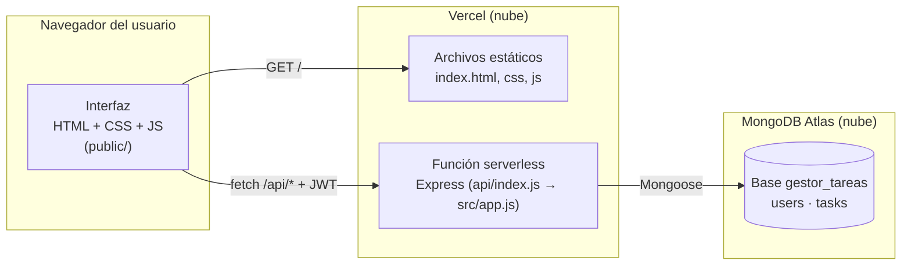
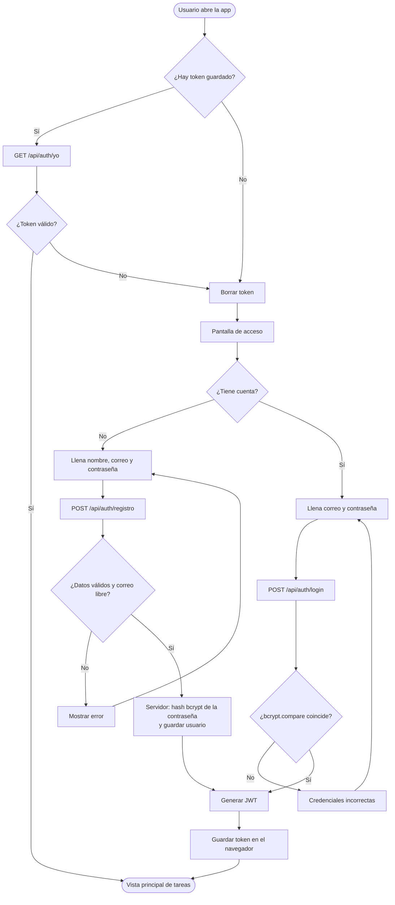
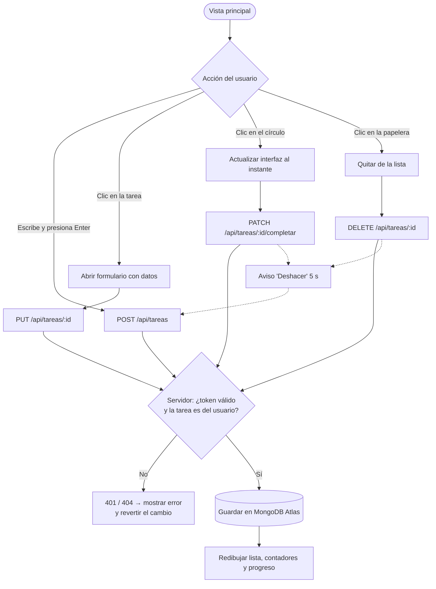
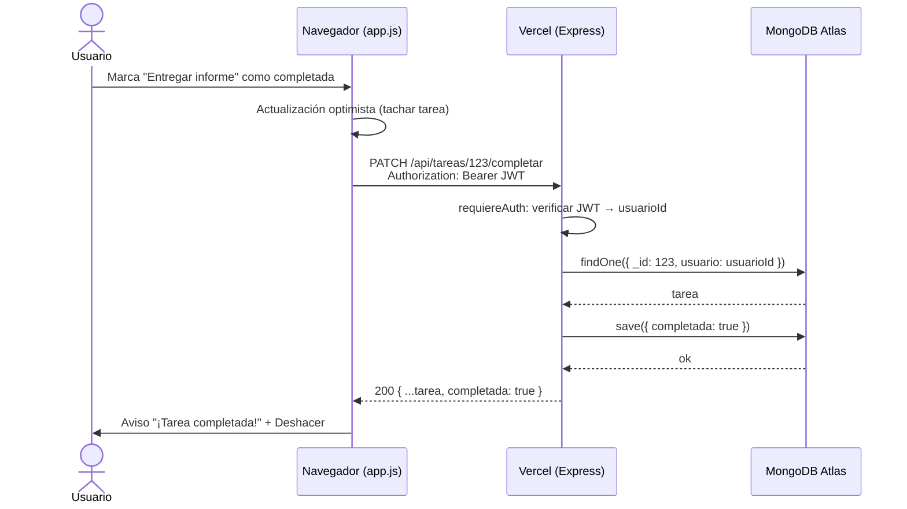
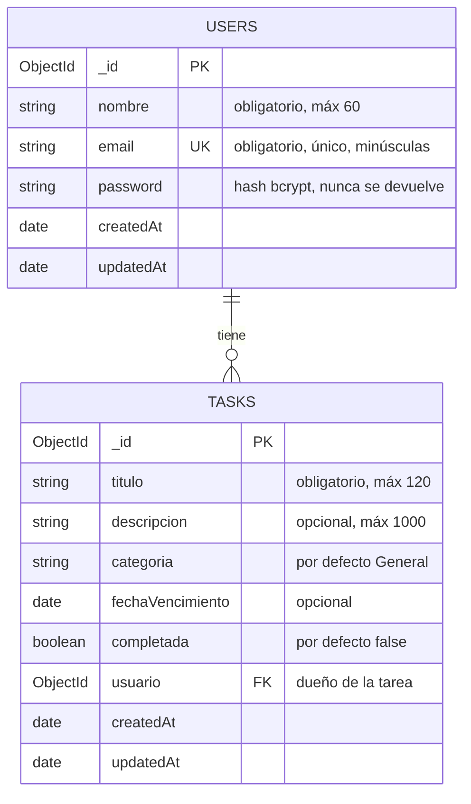

# 1. Planificación y diseño

Documento de diseño del **Gestor de tareas con Node.js**, trabajo final colaborativo del curso de Programación distribuida.

> Los diagramas están escritos en [Mermaid](https://mermaid.js.org/). GitHub y VS Code (con la extensión *Markdown Preview Mermaid Support*) los muestran como imágenes. También se pueden pegar en <https://mermaid.live> para exportarlos como PNG para las diapositivas.

## 1.1 Objetivo y alcance

Aplicación web donde cada usuario gestiona sus propias tareas.

| Requisito del enunciado | Cómo se cumple |
|---|---|
| Registro de usuarios | Formulario "Crear cuenta" → `POST /api/auth/registro`. Los datos se guardan en MongoDB |
| Inicio de sesión | Formulario "Iniciar sesión" → `POST /api/auth/login`. La contraseña se verifica contra el hash guardado |
| Crear tareas (título, descripción, categoría, fecha opcional) | Barra de "Agregar rápido" y formulario "Más detalles" → `POST /api/tareas` |
| Editar tareas | Clic en la tarea → `PUT /api/tareas/:id` |
| Marcar como completadas | Círculo de la tarea → `PATCH /api/tareas/:id/completar` |
| Eliminar tareas | Icono de papelera (con "Deshacer") → `DELETE /api/tareas/:id` |
| Organizar por categorías | Menú lateral de categorías y agrupación en la vista "Todas" |
| Interfaz intuitiva (HTML, CSS, JS) | `public/`, sin frameworks; modo oscuro y diseño adaptable a celular |
| Almacenamiento persistente | MongoDB Atlas (en la nube) mediante Mongoose |
| Seguridad (hash de contraseñas) | bcrypt con 10 rondas de sal + JWT + aislamiento por usuario |

Características adicionales (sección *Creatividad* de las consideraciones): vistas *Hoy / Próximos 7 días / Vencidas*, búsqueda sin tildes, barra de progreso, deshacer, atajos de teclado, publicación en Vercel.

## 1.2 Arquitectura

Arquitectura cliente-servidor de tres capas, distribuida en tres servicios:



| Capa | Tecnología | Responsabilidad |
|---|---|---|
| Presentación | HTML, CSS, JavaScript | Mostrar las tareas, capturar acciones, guardar el token de sesión |
| Lógica / API | Node.js + Express | Rutas REST, validación, autenticación JWT, reglas de acceso |
| Datos | MongoDB Atlas + Mongoose | Persistencia, validación de esquema, índices |

**¿Por qué es "distribuida"?** El cliente, el servidor de aplicación y la base de datos corren en máquinas distintas y se comunican por red (HTTP/JSON entre navegador y API; protocolo de MongoDB sobre TLS entre API y Atlas). Atlas además replica los datos en un *replica set* de 3 nodos (`shard-00-00`, `-01`, `-02`).

## 1.3 Diagramas de flujo

### Registro e inicio de sesión



### Gestión de una tarea



### Recorrido de una petición (secuencia)



## 1.4 Diseño de la base de datos

MongoDB es una base de datos **NoSQL orientada a documentos**. Se usan dos colecciones relacionadas por referencia (`tasks.usuario → users._id`):



Ejemplo de documentos reales:

```json
// colección users
{ "_id": "6ae0c0f5be3c3503c18c81f3", "nombre": "Ana", "email": "ana@correo.com",
  "password": "$2a$10$.uzNSvE7nfaRmDddP9PbNODYKDG9xHAyGzhJvmikrqbrDneOStaGq",
  "createdAt": "2026-10-27T15:07:25Z", "updatedAt": "2026-10-27T15:07:25Z" }

// colección tasks
{ "_id": "6ae0be2ed52cd41ba45a330b", "titulo": "Entregar informe", "descripcion": "Capítulo 1",
  "categoria": "Universidad", "fechaVencimiento": "2026-10-30T00:00:00Z", "completada": false,
  "usuario": "6ae0c0f5be3c3503c18c81f3", "createdAt": "...", "updatedAt": "..." }
```

### Índices

| Colección | Índice | Para qué |
|---|---|---|
| users | `{ email: 1 }` único | Evitar correos repetidos y buscar rápido al iniciar sesión |
| tasks | `{ usuario: 1, completada: 1, fechaVencimiento: 1 }` | Listar las tareas de un usuario ordenadas por estado y fecha |
| tasks | `{ usuario: 1, categoria: 1 }` | Filtrar y agrupar por categoría |

### ¿Por qué referencias y no documentos embebidos?

Las tareas podrían guardarse dentro del documento del usuario, pero un usuario puede tener cientos de tareas y cada edición reescribiría el documento completo (MongoDB limita los documentos a 16 MB). Con colecciones separadas cada tarea se lee y modifica de forma independiente, y los índices hacen eficientes las consultas por usuario.

## 1.5 Estructura de carpetas

```
gestor-tareas/
├── api/index.js              # Entrada en Vercel (función serverless)
├── src/
│   ├── app.js                # Aplicación Express: middlewares, rutas, errores
│   ├── server.js             # Arranque local (npm start)
│   ├── config/db.js          # Conexión a MongoDB reutilizable
│   ├── models/               # Esquemas Mongoose (User, Task)
│   ├── middleware/auth.js    # Verificación del JWT
│   └── routes/               # auth.js (registro/login) y tasks.js (CRUD)
├── public/                   # Frontend: index.html, css/, js/api.js, js/app.js
├── test/                     # Pruebas automatizadas (node:test + supertest)
├── scripts/probar-conexion.js
├── docs/                     # Esta documentación
├── .github/workflows/        # Integración continua (GitHub Actions)
├── vercel.json · .vercelignore
├── .env.example              # Plantilla de configuración (sin secretos)
└── package.json
```

Se sigue el patrón **MVC adaptado a una API**: *modelos* (`models/`), *controladores* (manejadores dentro de `routes/`) y la *vista* es el frontend independiente en `public/`, que solo habla con la API por HTTP.

## 1.6 Decisiones de diseño e implementación

| Decisión | Alternativas | Por qué |
|---|---|---|
| **Express** como framework | Fastify, NestJS | Es el sugerido en el enunciado, simple y muy documentado |
| **MongoDB Atlas** | MongoDB local | No depende de la memoria del PC (tuvimos caídas por falta de RAM) y la app publicada puede acceder desde internet |
| **JWT** en el encabezado `Authorization` | Sesiones con cookies | La API no guarda estado de sesión: funciona igual con varias instancias serverless en Vercel |
| **bcryptjs** (10 rondas) | Guardar la contraseña cifrada, SHA-256 | bcrypt es lento a propósito y agrega sal: resiste ataques de diccionario. Una contraseña cifrada podría descifrarse; un hash no |
| Frontend **sin frameworks** | React, Vue | El enunciado pide HTML, CSS y JS; además se carga rápido sin compilar |
| Construir el HTML con `createElement`/`textContent` | `innerHTML` | Evita inyección de código (XSS) con lo que escriben los usuarios |
| Filtrado y búsqueda **en el navegador** | Pedir al servidor en cada filtro | Las tareas de un usuario ya están cargadas; filtrar localmente es instantáneo y ahorra peticiones |
| **Actualización optimista** al completar/eliminar | Esperar la respuesta | La interfaz responde de inmediato; si el servidor falla se revierte |
| **Vercel** (serverless) | Render, Railway, VPS | Gratuito, despliegue con un comando y HTTPS automático |
| Conexión a MongoDB **reutilizable** | Conectar en cada petición | Abrir una conexión a Atlas tarda ~1 s; reutilizarla mantiene rápidas las respuestas |
| DNS públicos de respaldo | — | En algunos Windows Node no resolvía `mongodb+srv://`; la app lo detecta y reintenta |

## 1.7 Rendimiento

- **Índices compuestos** en `tasks` para que las consultas por usuario no recorran toda la colección.
- **`.lean()`** en las lecturas: Mongoose devuelve objetos simples, más rápidos de serializar a JSON.
- **Agregación en MongoDB** (`$group`) para contar tareas por categoría, en lugar de traerlas todas al servidor.
- **Una sola petición** al entrar: el frontend descarga las tareas una vez y calcula vistas, contadores y búsqueda localmente.
- **Conexión reutilizada** entre peticiones en Vercel (ver `src/config/db.js`).
- El frontend no usa librerías externas: `app.js` + `api.js` + CSS pesan menos de 50 KB.
