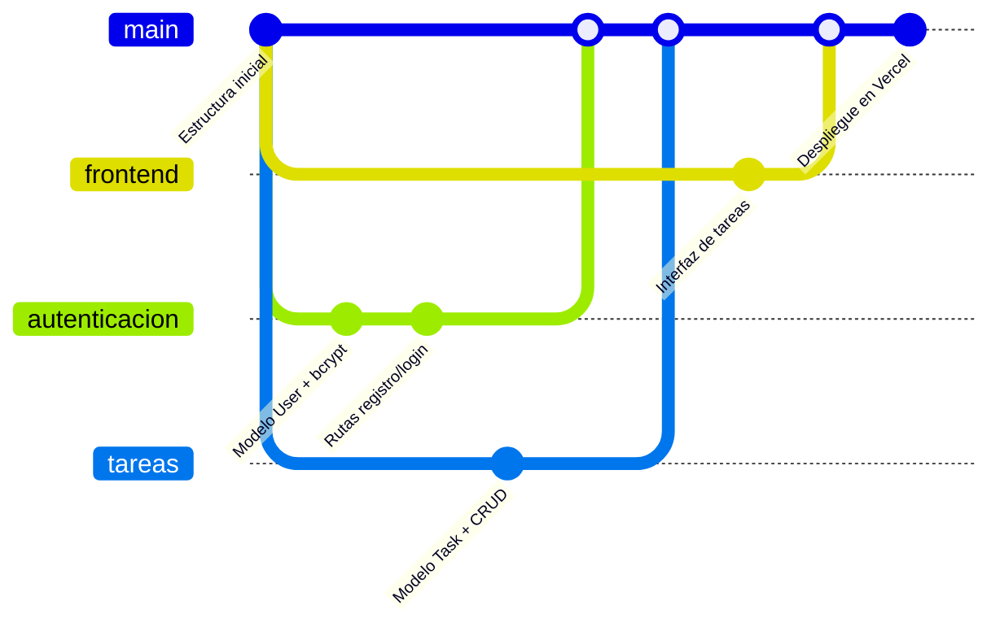

# 3. División de tareas y control de versiones

El CIPAS tiene **3 integrantes**. Cada uno es dueño de un área, pero todos deben entender el proyecto completo para la sustentación.

> Reemplacen *Integrante 1, 2 y 3* por sus nombres.

## 3.1 Responsables por área

| Integrante | Área | Archivos principales | Entregables |
|---|---|---|---|
| **Integrante 1** — Frontend e interfaz | Diseño y comportamiento de la interfaz | `public/index.html`, `public/css/styles.css`, `public/js/app.js`, `public/js/api.js` | Pantalla de acceso, vistas, formulario de tareas, notificaciones, diseño móvil y modo oscuro. Pruebas manuales (sección 2.2) |
| **Integrante 2** — Autenticación y seguridad | Usuarios, contraseñas y sesiones | `src/models/User.js`, `src/routes/auth.js`, `src/middleware/auth.js`, `test/auth.test.js` | Registro, login, hash con bcrypt, JWT, protección de rutas. Sección de ética y privacidad |
| **Integrante 3** — Gestión de tareas, base de datos y despliegue | Lógica de tareas y la infraestructura | `src/models/Task.js`, `src/routes/tasks.js`, `src/config/db.js`, `src/app.js`, `test/tareas.test.js`, `vercel.json`, `.github/workflows/` | CRUD de tareas, categorías, índices, conexión a Atlas, Vercel e integración continua |

**Compartido por los tres:** documentación (`README.md`, `docs/`), revisión del código de los demás y preparación de la sustentación.

## 3.2 Plan de trabajo por etapas

| Etapa | Actividades | Responsable |
|---|---|---|
| 1. Planificación | Leer el enunciado, diagramas de flujo, diseño de la base de datos, estructura de carpetas (`docs/01`) | Los tres |
| 2. Base del proyecto | `package.json`, Express, conexión a MongoDB, `.env.example` | Integrante 3 |
| 3. Desarrollo en paralelo | Modelo y rutas de usuario · Modelo y rutas de tareas · Maqueta de la interfaz | Integrantes 2 · 3 · 1 |
| 4. Integración | Conectar la interfaz con la API (`api.js`), probar el flujo completo | Integrante 1 con apoyo de 2 y 3 |
| 5. Pruebas | Pruebas automatizadas de cada área + pruebas manuales (`docs/02`) | Cada uno las de su área |
| 6. Despliegue | MongoDB Atlas, Vercel, GitHub Actions | Integrante 3 |
| 7. Documentación y sustentación | README, JSDoc, ensayo de la presentación (`docs/04`) | Los tres |

## 3.3 Control de versiones con Git

El proyecto es un repositorio Git. Flujo de trabajo recomendado para colaborar sin pisarse el trabajo:



### Pasos para cada integrante

1. **Una sola vez:** clonar el repositorio e instalar dependencias.
   ```bash
   git clone https://github.com/USUARIO/gestor-tareas.git
   cd gestor-tareas
   npm install
   ```
   Copiar `.env.example` como `.env` y pedir los datos de conexión al Integrante 3 por un canal privado (nunca subir el `.env` a GitHub).

2. **Para cada funcionalidad**, crear una rama desde `main` actualizado:
   ```bash
   git switch main
   git pull
   git switch -c tareas/filtro-por-categoria
   ```

3. Hacer commits pequeños con mensajes descriptivos:
   ```bash
   git add src/routes/tasks.js test/tareas.test.js
   git commit -m "Agregar filtro de tareas por categoría"
   ```

4. Antes de compartir, comprobar que todo pasa:
   ```bash
   npm test
   ```

5. Subir la rama y abrir un **Pull Request** en GitHub. Otro integrante lo revisa; GitHub Actions ejecuta las pruebas automáticamente. Cuando todo está en verde, se fusiona en `main`.
   ```bash
   git push -u origin tareas/filtro-por-categoria
   ```

### Buenas prácticas acordadas

- `main` siempre debe funcionar: no se trabaja directamente sobre ella.
- Mensajes de commit en español, en infinitivo y descriptivos ("Agregar…", "Corregir…").
- Nunca subir `.env`, `node_modules` ni contraseñas (ya están en `.gitignore`).
- Si dos personas tocan el mismo archivo, avisar en el grupo antes.

## 3.4 Comunicación del equipo

Las consideraciones sugieren herramientas como **Slack** o **Discord**. Propuesta:

| Canal | Uso |
|---|---|
| `#general` | Avisos, reuniones, fechas de entrega |
| `#desarrollo` | Dudas técnicas, enlaces a Pull Requests |
| `#errores` | Reportar fallos con captura y pasos para reproducirlos |
| Reunión semanal (30 min) | Qué hizo cada uno, qué sigue, qué bloquea |

También se pueden usar los *Issues* de GitHub como lista de pendientes, asignando cada uno a un integrante.
